### <code>dawtrin@github ~ $ ./contributions.sh --view=heatmap</code>

 

<b>🏙️ Click to View: 3D Skyline (Commit City)</b>

 

<b>⏱️ Click to View: 360° Radar Calendar (Round The Year)</b>

 

 

### <code>dawtrin@github ~ $ whoami</code>

<table>
<tr>
<td valign="top" align="center"></td>
<td valign="top"></td>
</tr>
</table>

  

### <code>dawtrin@github ~ $ ./connect.sh --socials</code>

  
  &nbsp;&nbsp;
  
  &nbsp;&nbsp;
  
  &nbsp;&nbsp;
  

 

